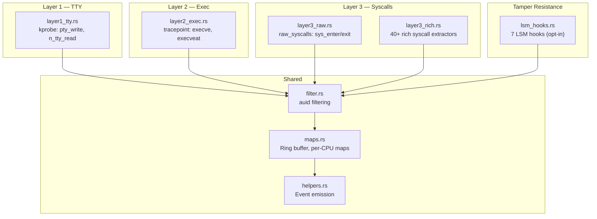

# bloodhound-ebpf

eBPF programs that run inside the kernel to trace user behavior. Compiled as `no_std` Rust targeting `bpfel-unknown-none` via the [Aya](https://aya-rs.dev/) framework.

## Program Layers

## Modules

| Module | Hook Type | Description |
|--------|-----------|-------------|
| `layer1_tty.rs` | kprobe | `pty_write` / `n_tty_read` — raw terminal I/O capture |
| `layer2_exec.rs` | tracepoint | `execve` / `execveat` — process execution with argv |
| `layer3_raw.rs` | tracepoint | `raw_syscalls` — generic syscall number + return code |
| `layer3_rich.rs` | tracepoint | 40+ syscall-specific extractors (openat, read, write, connect, bind, mkdir, etc.) |
| `lsm_hooks.rs` | LSM | 7 hooks (opt-in via `--enable-lsm`): `task_kill` and `ptrace_access_check` enforce daemon protection; `bpf` is observe-only (always returns 0); other hooks retain behavior. Attachment does not imply every hook enforces. |
| `signal.rs` | raw tracepoint | Non-enforcing `signal_generate` observation with sender and target identity |
| `filter.rs` | — | `should_trace()` — auid-based event filtering |
| `maps.rs` | — | BPF map definitions (ring buffer, per-CPU arrays, hash maps; socket table and excluded ports removed) |
| `helpers.rs` | — | `emit_event()`, `bpf_memcpy()`, drop counter |

## Kernel Struct Offsets

Member offsets for process lifecycle, namespace membership, mount/exec views, fd identity, and TTY classification are resolved at runtime from the target kernel's BTF (`/sys/kernel/btf/vmlinux`) and injected before eBPF load. No hardcoded struct offsets remain. See [docs/ebpf-offsets.md](../docs/ebpf-offsets.md) for details.
