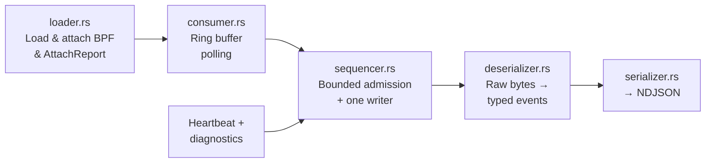

# bloodhound

Userspace daemon that loads eBPF programs, consumes events from the ring buffer, and emits structured NDJSON to stdout.

## Architecture



## Modules

| Module | Description |
|--------|-------------|
| `main.rs` | Entry point, tokio runtime, signal handling |
| `cli.rs` | Command-line argument parsing (`--uid`, `--enable-lsm`, `--heartbeat-interval`, etc.) |
| `loader.rs` | Loads eBPF bytecode via Aya, attaches tracepoints/kprobes/LSM/USDT, produces `AttachReport` |
| `ready.rs` | Startup facts validation (`boot_id`, `auid`, `excluded`, cadence) and `bloodhound_ready` emission |
| `consumer.rs` | Polls the BPF ring buffer for raw events |
| `sequencer.rs` | Defines bounded cross-producer admission order and the single fallible NDJSON path |
| `clock.rs` | Reads VM `CLOCK_MONOTONIC` nanoseconds for userspace-synthesized events |
| `deserializer.rs` | Deserializes raw byte buffers into typed event structs (historical decode for packets) |
| `serializer.rs` | Serializes events to NDJSON (`BehaviorEvent` schema) |
| `drop_counter.rs` | Polls the BPF drop counter and reports to stderr |
| `shutdown.rs` | Graceful shutdown coordination |

## Build

```bash
# Via Docker (recommended)
make build-docker

# Native (Linux only, requires nightly + bpf-linker)
cargo build -p bloodhound --release --target x86_64-unknown-linux-musl
```

The eBPF bytecode is compiled by `build.rs` via `aya_build::build_ebpf()` and embedded in the binary at compile time.

## Usage

```bash
bloodhound --uid 1000                     # trace user with UID 1000 (default non-enforcing)
bloodhound --uid 1000 --enable-lsm        # opt-in LSM hooks (task_kill/ptrace enforcement, bpf observe)
```
